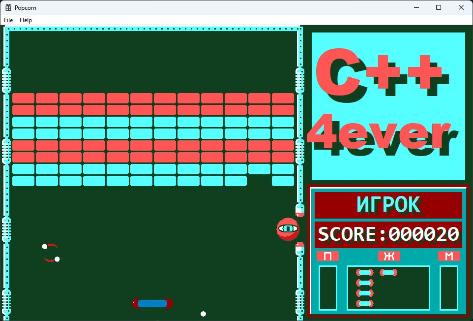

<h1 align="center">PopCorn</h1>

<p align="center"><strong>An Arkanoid-style brick breaker for Windows.</strong></p>

<p align="center">
  <a href="#gameplay"><strong>Gameplay</strong></a> ·
  <a href="#controls"><strong>Controls</strong></a> ·
  <a href="#build-from-source"><strong>Build from source</strong></a> ·
  <a href="#source-guide"><strong>Source guide</strong></a>
</p>

<p align="center">
  
  
</p>

<p align="center">
  
</p>

<p align="center"><sub>Level 1 in play.</sub></p>

## Gameplay

Keep the ball in play with your paddle and clear the breakable bricks to reach the next stage. Catch falling letters to change the rules mid-round.

- **Ten levels.** Brick layouts mix breakable blocks, solid obstacles, and portals that send the ball across the board.
- **Letter bonuses.** Split the ball into three, widen the paddle, catch the ball with glue, or turn the paddle into a laser. Other letters can freeze monsters, add a temporary floor, or skip a level.
- **Monsters and score.** Monsters enter through gates and deflect the ball. Breaking bricks and destroying monsters earn points. The side panel shows your name, score, and remaining lives.
- **Animated transitions.** A missed ball costs a life and melts the paddle before a new one rolls in. A mechanical mop sweeps the board between levels.

## Controls

Type a player name and press **Enter** to start.

| Key | Action |
| --- | --- |
| <kbd>←</kbd> / <kbd>→</kbd> | Move the paddle |
| <kbd>Space</kbd> | Launch the ball, release it from a sticky paddle, or fire in laser mode |

## Build from source

On Windows, install Visual Studio with **Desktop development with C++**, the **MSVC v143** toolset, and a Windows SDK. Use a regular case-insensitive Windows folder for the checkout.

Open [Popcorn.sln](Popcorn.sln), select **Release · x64**, and press <kbd>Ctrl</kbd>+<kbd>F5</kbd> to build and play. You can also run these commands from **Developer PowerShell for Visual Studio**.

```powershell
git clone https://github.com/WonVoyage/PopCorn.git
cd PopCorn
msbuild Popcorn.sln /m /p:Configuration=Release /p:Platform=x64
.\x64\Release\Popcorn.exe
```

With Visual Studio 2026 and the **v145** toolset installed, you can add `/p:PlatformToolset=v145` to the MSBuild command.

## Source guide

| File | What to look for |
| --- | --- |
| [`Main.cpp`](Popcorn/Main.cpp) | Win32 window, keyboard input, and double-buffered GDI rendering |
| [`Engine.cpp`](Popcorn/Engine.cpp) | Game states, collisions, and power-up effects |
| [`Level_Data.cpp`](PopCorn/Level_Data.cpp) | The ten level layouts |
| [`Platform.cpp`](Popcorn/Platform.cpp) | Paddle movement and power-up modes |
